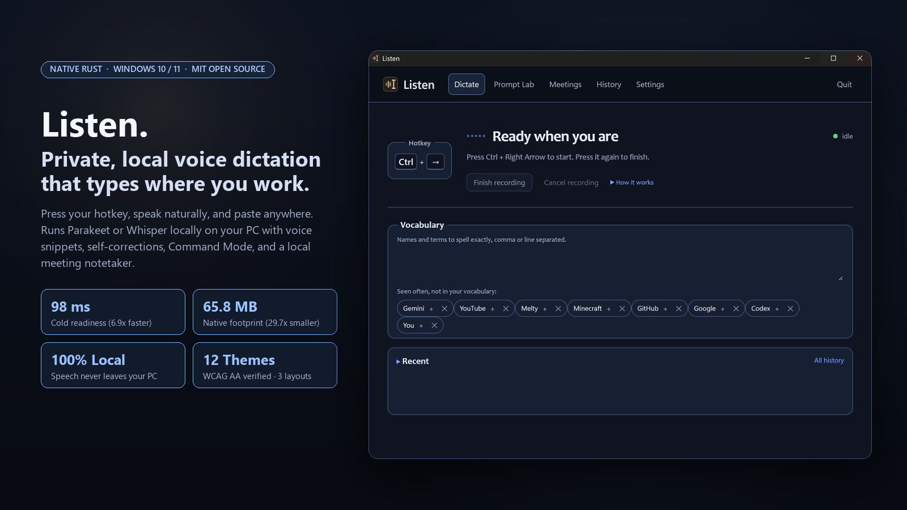
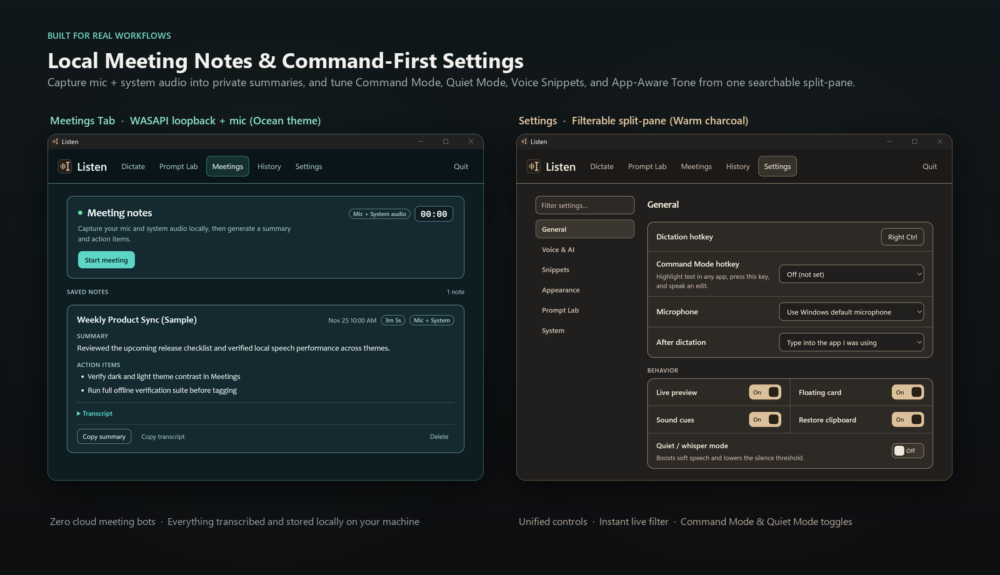
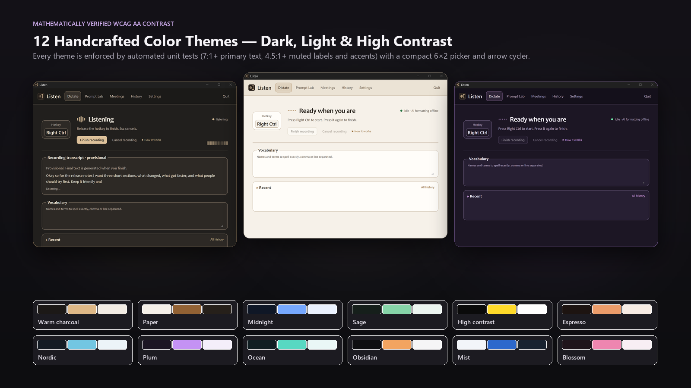
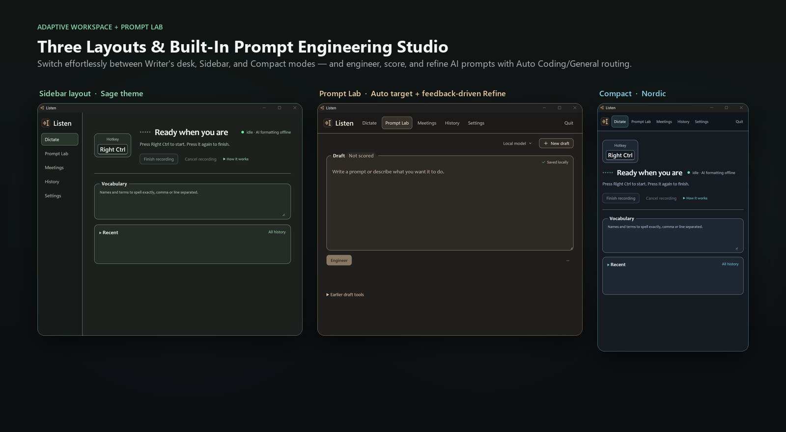

<div align="center">

# Listen (`listen-rs`)

**Fast, private, 100% local voice dictation, Command Mode, and meeting notetaker for Windows — written in native Rust.**

[](LICENSE)
[](#quick-start)
[](Cargo.toml)
[](#privacy-and-local-first-architecture)

*An open-source, zero-subscription, offline-first alternative to cloud voice typing apps like Wispr Flow — built specifically for Windows 10 & 11.*

<br />



</div>

---

## What is Listen?

**Listen** is a lightweight, native **Windows push-to-talk speech-to-text and voice productivity app** built in **Rust**. Hold `Right Ctrl` (or any custom keyboard shortcut or Xbox-compatible controller button), speak naturally in any Windows app, and release — Listen transcribes your speech **locally on your computer** using **Parakeet Unified 0.6B** or **Whisper**, applies deterministic voice cleanup, and types straight into your active window while preserving your clipboard.

Unlike subscription-based cloud dictation apps, **your microphone audio, meeting recordings, and dictation history never leave your PC**. Optional AI formatting runs locally through **Ollama** (or your own API key for Claude, OpenAI, or Gemini only when you explicitly enable it).

> **Looking for the original Python/JS prototype?** Listen (`listen-rs`) is the native Rust successor to [Sczitzo/Listen](https://github.com/Sczitzo/Listen) — **6.9× faster cold readiness**, **29.7× smaller runtime footprint**, plus Voice Snippets, Natural Self-Corrections, Command Mode, App-Aware Tone, Quiet/Whisper Mode, Local Meeting Notes, and 12 WCAG AA themes.

---

## Core Features

### Voice Dictation That Understands How People Actually Talk
- **Push-to-Talk & Hands-Free Toggle:** Hold `Right Ctrl` to dictate and release to paste, or tap once for hands-free recording (`Esc` cancels). Supports custom hotkeys and Xbox-compatible game controllers.
- **Natural Mid-Sentence Self-Corrections:** Change your mind mid-sentence without re-recording.
  - *"Let's meet at 4 PM, actually make that 3 PM"* → **`Let's meet at 3 PM`**
  - *"Send it on Tuesday, no wait Wednesday"* → **`Send it on Wednesday`**
  - *"Call Alex, I mean Jordan"* → **`Call Jordan`**
  - Deterministic, local, and safety-guarded so normal prose like *"Actually, let's meet tomorrow"* stays untouched.
- **Voice Snippets:** Expand short spoken triggers into full templates, email addresses, links, or multi-line signatures (`"my email"` → `you@example.com`, `"my sig"` → multi-line sign-off) with case-insensitive, whole-word safety so partial words are never corrupted.
- **Safe Spoken Lists & Content Guards:** Say *"Make a shopping list: apples, pears, and milk"* or *"Make a numbered list..."* for automatic bulleted, numbered, or lettered lists. Strict safety checks reject AI hallucinations that alter numbers, file paths, flags, negations, or proper nouns.
- **Quiet / Whisper Mode:** Adaptive soft-speech gain and a lowered silence threshold so you can dictate quietly late at night or in shared offices.

### Command Mode, App-Aware Tone & Local Meeting Notes
- **Command Mode (Voice-Edit Anywhere):** Highlight text in any Windows app, press your Command Mode hotkey, and speak an edit (*"make this more concise"*, *"turn into bullet points"*, *"fix grammar"*) — Listen transforms the selection and pastes it back while restoring your previous clipboard.
- **App-Aware Tone & Style:** Automatically adapts formatting style to the app you're typing in — **Casual** (Discord, Slack, Teams, WhatsApp), **Polished** (Outlook, Word, Gmail, Notion, Docs), or **Technical** (VS Code, Cursor, Terminal, PowerShell, JetBrains) — with custom per-app overrides.
- **Local Meeting Notetaker (`Meetings` tab):** Captures **system audio (WASAPI loopback) + microphone** simultaneously with zero cloud meeting bots. Generates local summaries, action items, and searchable transcripts saved privately on your disk.

<div align="center">
  
</div>

### 12 WCAG AA Themes, 3 Adaptive Layouts & Built-In Prompt Lab
- **12 Mathematically Verified WCAG AA Themes:** `Warm charcoal`, `Paper`, `Midnight`, `Sage`, `High contrast`, `Espresso`, `Nordic`, `Plum`, `Ocean`, `Obsidian`, `Mist`, and `Blossom`. Every theme is verified by automated unit tests (`≥ 7.0:1` primary text contrast, `≥ 4.5:1` muted labels and accents) and selectable from a compact 6×2 swatch grid or `‹`/`›` quick cycler.
- **3 Workspace Layouts:** `Writer's desk` (full top tabs), `Sidebar` (left navigation rail), and `Compact` (slim single-column desktop companion).
- **Prompt Lab (Built-In Prompt Engineering Studio):** Turn rough spoken ideas into structured prompts for coding agents or general AI. Features **Auto target detection** (*Coding agent* vs. *General AI*), strict `<draft>` anti-execution boundaries, a 6-criterion rubric scorer (1–10), **feedback-driven Refine** that feeds checker gaps back to the writer, and native JSON enforcement across Ollama, OpenAI, Gemini, and Claude.
- **In-App Model Manager & Live Benchmarker:** Download local speech models and benchmark local Ollama formatting models directly inside Settings.

<div align="center">
  
</div>

<br />

<div align="center">
  
</div>

---

## Benchmarks: Native Rust vs. Python/JS vs. Cloud Apps

Measured directly on Windows 11 (RTX 4060 8 GB) using an isolated automated comparison harness:

| Metric | Listen (`listen-rs`, Rust) | Original Listen (Python/JS) | Typical Cloud Dictation Apps |
|---|---|---|---|
| **Cold readiness (median ×5)** | **98.0 ms** *(6.9× faster)* | 672.7 ms (Python import) | Cloud round-trip per utterance |
| **Runtime footprint** *(excl. speech weights)* | **65.2 MB** *(11.6 MB `.exe` + 53.6 MB DLLs)* | 1,950.5 MB *(14 pip/CUDA packages)* | Electron / cloud client |
| **External runtime installs** | **0** *(100% pure-Rust GPU UI, zero WebView2/JS)* | Python 3.13 + 14 pinned packages | Account + always-on cloud |
| **Speech privacy** | **100% local (offline)** | 100% local (offline) | Audio uploaded to cloud servers |
| **Monthly cost** | **\$0 (MIT open source)** | \$0 (MIT open source) | \$10–\$15 / month subscription |
| **30-case dictation corpus** | **30 / 30 (100%)** | 18 / 30 (60%) | Proprietary / unverified |
| **Natural self-corrections** | **Yes (deterministic local)** | No | Cloud LLM dependent |
| **Voice Snippets & Command Mode** | **Yes** | No | Paid tiers |
| **App-Aware Tone & Quiet Mode** | **Yes** | No | Partial / paid |
| **Local Meeting Notetaker** | **Yes (WASAPI loopback + mic)** | No | Separate paid bot / cloud upload |
| **Color themes & layouts** | **12 WCAG AA themes · 3 layouts** | 1 theme · 1 layout | 1–2 themes |
| **Automated verification** | **100+ Rust tests + pure-Rust `--ui-check` + 13 parity** | 78 Python suites | Closed |

---

## Quick Start

### Option 1: Portable Windows Release (Recommended)
1. Download the latest `Listen-windows-x64.zip` from **[Releases](https://github.com/Sczitzo/listen-rs/releases)**.
2. Extract to any folder (for example `G:\Apps\Listen` or `C:\Tools\Listen`).
3. Double-click **`Listen.exe`**.
4. Hold **`Right Ctrl`**, speak into any app, and release.

**Requirements:** Windows 10 (1903+) or Windows 11 (x64). Zero browser runtime or WebView2 required — the entire UI and engine run natively in pure Rust (`eframe`/`egui`). Optional local AI formatting uses [Ollama](https://ollama.com/) (`http://127.0.0.1:11434`).

### Option 2: Build from Source (Rust)

**Prerequisites:** [Rust stable](https://rustup.rs/) (MSVC toolchain) + Windows 10/11 SDK (`rc.exe` for embedding the native app icon).

```powershell
git clone https://github.com/Sczitzo/listen-rs.git
cd listen-rs

# Run all 101+ unit tests (includes WCAG AA contrast, self-corrections, snippets & tone checks)
cargo test --locked

# Build optimized native Windows release binary (target\release\listen-rs.exe)
cargo build --release --locked
```

To assemble a portable `dist\Listen\` folder with the local `transcribe.dll` speech runtime and Parakeet model:

```powershell
.\package.bat
```

To run the parity verification suite and native pure-Rust UI check:

```powershell
python tools/check_mechanics.py
.\target\release\listen-rs.exe --ui-check .\temp-ui-check
```

---

## Privacy & Local-First Architecture

| Data | Where It Runs | Leaves Your PC? |
|---|---|---|
| **Voice dictation audio** (Parakeet / Whisper) | Locally on CPU or Vulkan GPU (`transcribe.dll`) | **Never** |
| **Meeting recordings** (WASAPI loopback + mic) | Locally on your computer | **Never** |
| **Self-corrections, Snippets, Spoken lists** | Deterministic native Rust rules | **Never** |
| **History, Vocabulary, Settings, Meeting notes** | Local files in `%APPDATA%\ListenRs` | **Never** |
| **Optional AI formatting / Command Mode / Prompt Lab** | Local Ollama by default (`127.0.0.1:11434`) | **Only if you opt into paid cloud** (Claude, OpenAI, or Gemini via environment variables) |
| **Telemetry / analytics / accounts** | None | **Never** |

---

## Frequently Asked Questions (FAQ)

### Is Listen a free, open-source alternative to Wispr Flow for Windows?
Yes. Listen gives Windows users the core everyday voice workflow — push-to-talk dictation in any app, natural mid-sentence self-corrections, Voice Snippets, Command Mode (highlight and voice-edit), App-Aware Tone, Quiet/Whisper Mode, and a Meeting Notetaker — completely free under the MIT license, with local offline speech recognition and no subscription or account required.

### Does Listen work completely offline?
Yes. Speech recognition (Parakeet Unified 0.6B and Whisper), self-corrections, voice snippets, spoken list formatting, meeting capture, and local History all work with zero internet connection. If you install Ollama locally, AI formatting, Command Mode, and Prompt Lab also run 100% offline.

### How does Listen compare to the original Python/JS version?
Listen (`listen-rs`) is a ground-up native Rust rebuild of [Sczitzo/Listen](https://github.com/Sczitzo/Listen). It keeps parity on core mechanics (`13/13` verified parity checks) while cutting cold startup from `672.7 ms` to `98.0 ms` (`6.9×` faster), shrinking the runtime footprint from `1.95 GB` to `65.8 MB` (`29.7×` smaller), removing the Python/CUDA dependency tree, and adding Voice Snippets, Natural Self-Corrections, Command Mode, App-Aware Tone, Quiet Mode, Local Meeting Notes, 12 WCAG AA themes, 3 layouts, and an upgraded Prompt Lab backend.

### Which speech and AI models are supported?
- **Local speech recognition:** Parakeet Unified English 0.6B (Q8_0 GGUF via `transcribe.dll` + Vulkan/CPU) and Whisper models, managed directly in Settings.
- **Local AI formatting & Prompt Lab:** Any local Ollama model (e.g., `qwen3.5:2b`, `qwen2.5:7b`, `llama3.2`), with a built-in model benchmarker.
- **Optional cloud providers:** Anthropic Claude, OpenAI, and Google Gemini (disabled by default; API keys are read only from environment variables, never stored in code or plain-text config files).

### Does Listen support game controllers or custom shortcuts?
Yes. You can bind any single modifier key (such as `Right Ctrl`), multi-key combo, or Xbox-compatible controller button in **Settings → General**.

---

## Keyboard Shortcuts

| Shortcut | Action |
|---|---|
| `Right Ctrl` (hold or tap) | Start / finish voice dictation |
| `Esc` | Cancel active recording or close open popover |
| Custom hotkey (Settings → General) | Command Mode (voice-edit highlighted text anywhere) |
| `Ctrl+1` … `Ctrl+5` | Switch between Dictate, Prompt Lab, Meetings, History, Settings |
| `Ctrl+K` | Open Command Palette |
| `Ctrl+Enter` | Paste active Prompt Lab draft into your previous window |

---

## Credits & License

Listen (`listen-rs`) is released under the **[MIT License](LICENSE)**, Copyright © 2026 Sczitzo.
See [NOTICE.md](NOTICE.md) for third-party speech runtime (`transcribe.dll` / `ggml`) and model licensing details, and [MECHANICS.md](MECHANICS.md) for technical architecture and parity measurements.
